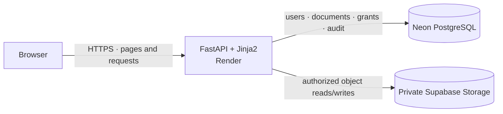

<div align="center">

# TrustVault

### Secure document sharing with explicit permissions and an auditable trail.

TrustVault is a server-rendered FastAPI application built for the Snovasys Fresher Hiring Challenge 2026. It gives document owners per-user read/edit controls, enforces access on the server for each request, and records allowed and denied activity.

[**Open the live application**](https://trustvault-ohg9.onrender.com/) · [API and access rules](API_ACCESS.md) · [Threat model](THREATS.md)

[](https://www.python.org/)
[](https://fastapi.tiangolo.com/)
[](https://www.postgresql.org/)
[](https://supabase.com/)
[](https://render.com/)

</div>

## Demo Video

Watch the TrustVault project demonstration (5 minutes 35 seconds).

**[Watch TrustVault Demo Video](https://drive.google.com/drive/folders/1FQr8RYhmoXzh6u8blmLFx41KHSu5Ta6h?usp=sharing)**

The video demonstrates document uploads, role-based access, document sharing, permission revocation, and audit logging.
  


## Why TrustVault?

Document IDs are not permissions. TrustVault checks the signed-in user's current identity and document grant on every protected request—including downloads—so a guessed identifier or a previously open session does not preserve access after revocation. The application combines that authorization model with private object storage integration and an HMAC-linked activity log, while documenting what remains unverified.


## Features

| Area | What is implemented |
|---|---|
| Document workflow | Upload, search, view, download, edit metadata, and owner deletion |
| Fine-grained sharing | Named-user read or edit grants; owner-controlled revocation |
| Server-side security | Per-request authentication and document authorization, CSRF protection, secure session settings, upload checks, and restrictive response headers |
| Audit trail | Allowed and denied activity with a keyed hash chain; PostgreSQL appends use a transaction-scoped advisory lock |
| Administration | Activity dashboard and user management; administrators do not automatically gain access to other users' documents |
| Storage | Local private filesystem for development/tests and a Supabase Storage adapter for private document objects |

## Roles and permissions

| Role | Permissions |
|---|---|
| **Owner** | Manage their documents and metadata; grant or revoke named-user read/edit access; delete their documents |
| **Editor** | View, download, and edit metadata for explicitly granted documents |
| **Viewer** | View and download explicitly granted documents |
| **Administrator** | Review activity, manage users, and own their own documents; no implicit access to other users' documents |

Downloads pass through FastAPI authorization before the private object is read. The application does not issue public or reusable storage download links. A permission revocation is checked on the next request, including when the viewer's session remains active.

## Architecture



Render's local filesystem is ephemeral. PostgreSQL and document objects are intended to persist in Neon and Supabase respectively; live provider persistence has not been independently verified.

## Security controls

- Document routes check identity and ownership/grants server-side; authenticated requests for unknown or unauthorized documents receive a non-disclosing 404, while unauthenticated requests receive 401.
- Downloads re-check the current permission before storage access. Revoking a grant blocks the viewer's next request rather than relying on session expiration.
- Write forms use CSRF tokens. Session cookies are HTTP-only and SameSite=Strict; configure `TRUSTVAULT_HTTPS=1` behind TLS for Secure cookies.
- Upload validation checks allowed extensions, file signatures, and size. This is not antivirus scanning.
- Mutation audit events share the database transaction. The hash chain is tamper-evident, not immutable: a database administrator can remove a tail or, with the application secret, recompute hashes.
- Supabase access is server-side. The configured bucket must be private; no storage key belongs in browser code or source control.

See [THREATS.md](THREATS.md) for mitigations, evidence, and residual risks.

## Tests

The last recorded complete local run was **98 passed, 0 failed, 0 skipped, 1 warning** (`python -m pytest -q`, 2026-10-24). The warning was Starlette's deprecation notice concerning `httpx` with `starlette.testclient`.

The suite uses isolated SQLite databases and temporary local file storage. It covers authorization, revocation, auditing, upload validation, storage behavior, and cloud-initialization helpers. It is **not** a PostgreSQL integration run and does not verify live Neon or Supabase behavior.

Run locally:

```powershell
python -m pytest -q
```

## Local setup (Windows)

For a guided local setup, run `start_windows.bat` from the repository root. It creates a virtual environment, installs dependencies, seeds local demo accounts, and starts the application. Generated local credentials are saved in the ignored `.local-demo-credentials.json`; never upload or reuse them for a hosted deployment.

Or create the environment manually in PowerShell:

```powershell
py -3 -m venv .venv
.\.venv\Scripts\python.exe -m pip install -r requirements.txt
```

Set `TRUSTVAULT_SECRET` and four distinct `SEED_*_PASSWORD` values (each at least 12 characters) in the current shell, then run:

```powershell
.\.venv\Scripts\python.exe -m scripts.seed
.\.venv\Scripts\python.exe -m uvicorn app.main:app --reload
```

Open <http://127.0.0.1:8000>. The demo usernames are `admin_demo`, `owner_demo`, `viewer_demo`, and `other_demo`; passwords are locally assigned and are not published here. `.env.example` contains placeholders only—the application does not automatically load it.

## Hosted deployment

The configured live URL is [trustvault-ohg9.onrender.com](https://trustvault-ohg9.onrender.com/). The intended architecture is Render Free for FastAPI/Jinja2, Neon PostgreSQL for relational data, and a private Supabase Storage bucket for document objects.

Render Free services can spin down after inactivity. The first request may take longer while the service starts; wait for startup and retry if needed.

1. Configure the Render Blueprint in [`render.yaml`](render.yaml), including secret environment variables. Keep `TRUSTVAULT_HTTPS=1` and use a stable, random `TRUSTVAULT_SECRET`.
2. Set Render's `DATABASE_URL` to the Neon pooled PostgreSQL URL with TLS enabled (`sslmode=require`; retain `channel_binding=require` when provided).
3. Create a **private** Supabase bucket named `trustvault-documents`. Configure `SUPABASE_URL`, `SUPABASE_STORAGE_BUCKET`, and the server-side `SUPABASE_SECRET_KEY` in Render.
4. Set four unique demo passwords of at least 12 characters. Wait for the service health check at `/health`.
5. From a trusted local Windows computer with dependencies installed, run `.\.venv\Scripts\python.exe .\scripts\initialize_cloud.py`. The script prompts locally for the direct Neon connection, Supabase settings, the existing application secret, and demo passwords. It validates connectivity and private-bucket configuration before initializing schema and idempotently adding missing demo accounts, a sample document, and its viewer grant. No paid Render shell is required.

Do not put passwords, provider keys, or database URLs in source control. The initializer does not change Render settings or overwrite existing demo-account passwords.

## Project documentation

- [Threat model and residual risks](THREATS.md)
- [AI assistance journal and evidence limitations](PROMPTS.md)
- [Project write-up](WRITEUP.md)
- [API endpoints and access rules](API_ACCESS.md)
- [Snovasys requirements checklist](REQUIREMENTS_CHECKLIST.md)

## Limitations and verification status

- **Manual live verification (project owner):** The project owner reports manually testing the deployed TrustVault website and confirms that its functionality is working. This is owner-reported manual verification, not an independently automated live test; no route-by-route results are asserted here.
- **Local automated tests:** The last recorded full local run was **98 passed, 0 failed, 0 skipped, 1 warning** using isolated SQLite databases and temporary file storage. These tests do not establish hosted-provider behavior.
- **PostgreSQL integration:** PostgreSQL integration tests were not separately executed. Live database behavior and persistence after a Render restart have not been independently verified.
- **Known architectural limitations:** Cross-system deletion is not atomic; if object deletion fails after the database transaction commits, an orphaned object can remain. The login rate limiter is in-memory and per-process. The audit chain is tamper-evident, not immutable. Upload validation does not include antivirus scanning. See [THREATS.md](THREATS.md) for the threat analysis and mitigations.
- [`PROMPTS.md`](PROMPTS.md) distinguishes code/commit-supported implementation facts from AI-interaction recollections that lack independent records. It does not claim that every historical entry is independently evidenced or that a required count of genuine dated entries has been established.

These statements distinguish the project owner's manual live confirmation from automated local tests and independent provider-integration evidence.
